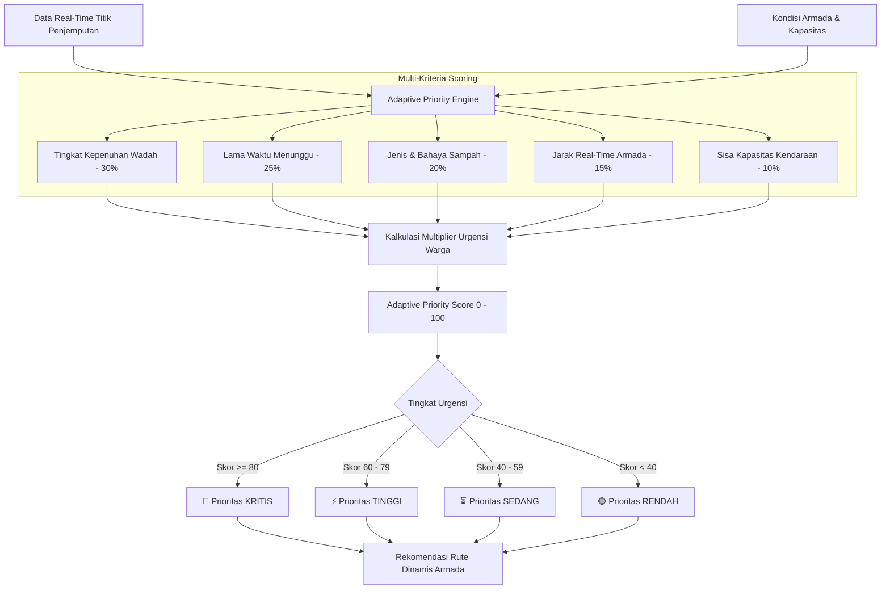

# 🌿 SIRAM-SAMPAH (Sistem Informasi Ramah Lingkungan & Manajemen Sampah)

<div align="center">

[-3DDC84?style=for-the-badge&logo=android&logoColor=white)](https://developer.android.com)
[](https://kotlinlang.org)
[](https://developer.android.com/jetpack/compose)
[](https://firebase.google.com)
[](https://developer.android.com/training/data-storage/room)
[](LICENSE)

**Aplikasi Pengelolaan Bank Sampah Cerdas Berbasis Android dengan *Adaptive Context-Aware Waste Collection Priority System (Decision Support System)* dan Antarmuka Modern *Pastel Mint & Butter Yellow*.**

[Fitur Utama](#-fitur-utama) • [Sistem Prioritas Adaptif (DSS)](#-sistem-prioritas-adaptif-dss) • [Arsitektur & Tech Stack](#-arsitektur--teknologi) • [Struktur Direktori](#-struktur-direktori-proyek) • [Panduan Instalasi](#-panduan-instalasi--menjalankan-aplikasi)

</div>

---

## 📖 Tentang Proyek

**SIRAM-SAMPAH** adalah platform ekosistem bank sampah berbasis mobile modern yang dirancang untuk menjembatani interaksi antara **warga/nasabah bank sampah** dan **pengelola/armada pengangkut**. 

Aplikasi ini tidak hanya berfungsi sebagai sistem pencatatan tabungan dan pelacakan armada statis, melainkan telah bertransformasi menjadi **Sistem Pendukung Keputusan (Decision Support System - DSS)** melalui algoritma **Adaptive Context-Aware Waste Collection Priority Engine**. Sistem ini secara dinamis menghitung urgensi penjemputan sampah berdasarkan kombinasi parameter real-time untuk menghasilkan rute pengangkutan sampah yang efisien, responsif, dan higienis bagi perkotaan maupun lingkungan pemukiman.

---

## 🧠 Sistem Prioritas Adaptif (DSS)

Inovasi utama dalam aplikasi ini adalah modul **Decision Support System (DSS)** yang mengatasi kelemahan rute penjemputan konvensional (*Nearest Neighbor*). Armada tidak lagi hanya mendatangi titik terdekat secara buta, melainkan memprioritaskan titik yang memiliki risiko penumpukan, bau busuk, atau bahaya lingkungan tertinggi.



### Parameter Multi-Kriteria & Bobot Penilaian

| Parameter | Simbol | Bobot ($w_i$) | Deskripsi & Rasionalisasi |
| :--- | :---: | :---: | :--- |
| **Tingkat Kepenuhan** | $C_{fill}$ | **30%** | Persentase volume tempat sampah ($0 - 100\%$). Mencegah tumpahan ke jalan. |
| **Waktu Menunggu** | $T_{wait}$ | **25%** | Durasi sejak request diajukan (dinormalisasi maks. 48 jam). Menjaga SLA pelayanan. |
| **Karakteristik Sampah** | $H_{type}$ | **20%** | Bahaya/dekomposisi: **B3 / Medis (1.0)**, **Organik (0.85)**, **Anorganik (0.50)**. |
| **Kedekatan Armada** | $D_{prox}$ | **15%** | Efisiensi bahan bakar dan waktu tempuh menggunakan formula jarak Haversine. |
| **Kapasitas Kendaraan** | $V_{cap}$ | **10%** | Menjamin armada tidak kelebihan muatan (*overload*) sebelum rute selesai. |

Skor akhir dihitung dengan normalisasi terbobot:
$$\text{Priority Score} = \left( \sum_{i=1}^{n} w_i \cdot S_i \right) \times M_{urgensi}$$
*dimana $M_{urgensi}$ adalah pengali tingkat keterdesakan yang dilaporkan warga.*

---

## ✨ Fitur Utama

### 👤 1. Portal Nasabah / Warga
- **Login Langsung Akun Google (One-Tap / Google Sign-In)**: Masuk secara instan menggunakan akun Google resmi tanpa perlu mengisi form manual, terintegrasi langsung dengan Firebase Authentication dan sinkronisasi profil Firestore otomatis.
- **Setor & Tabungan Sampah**: Input berat sampah per kategori (Plastik, Kertas, Logam, Kaca, Organik) dengan kalkulasi konversi rupiah dan poin otomatis.
- **Request Jemput Sampah**: Pengajuan penjemputan langsung dari rumah lengkap dengan koordinat GPS, foto sampah, estimasi berat, dan catatan urgensi.
- **Lacak Armada Real-Time**: Pemantauan posisi truk/motor pengangkut sampah secara langsung pada peta interaktif Google Maps.
- **Mutasi & Tarik Saldo**: Penarikan saldo tabungan bank sampah via transfer bank / e-wallet beserta riwayat transaksi transparan.
- **AI Chatbot Ramah Lingkungan**: Asisten cerdas untuk konsultasi pemilahan sampah, tips daur ulang kreatif, dan panduan gaya hidup *zero-waste*.
- **Ekspor Riwayat PDF**: Unduh laporan riwayat penyetoran sampah resmi dalam format dokumen PDF.

### 🛡️ 2. Portal Admin & Pengelola
- **Dashboard Operasional**: Ringkasan volume sampah terkumpul, saldo total nasabah, dan status armada aktif.
- **Decision Support Control Panel**: Tampilan antrean prioritas berbasis skor adaptif dengan kode warna visual, filter urgensi, dan tombol *Accept/Dispatch*.
- **Manajemen Harga Dinamis**: Pembaruan tarif beli sampah per kilogram secara fleksibel mengikuti fluktuasi pasar daur ulang.
- **Broadcast Pengumuman**: Kirim pengumuman jadwal kerja bakti, perubahan jam operasional, atau pesan edukasi ke seluruh warga secara instan.
- **Super Admin Governance**: Manajemen hak akses pengguna (*User Roles*: Citizen, Admin, Super Admin).

---

## 🎨 Desain Antarmuka (Pastel Mint & Butter Yellow Theme)

Aplikasi dibangun dengan bahasa desain modern yang segar, bersih, dan ramah lingkungan:
- **Warna Utama**: *Pastel Mint* (`#74C69D`, `#52B788`, `#D8F3DC`) melambangkan keberlanjutan dan keasrian alam.
- **Warna Aksen**: *Butter Yellow* (`#FFE57F`, `#FFF3B0`, `#FFD166`) memberikan kesan hangat, energik, dan ramah.
- **Tipografi & Komponen**:
  - Kartu dengan sudut membulat modern (*Rounded Corner Radius* 20–24 dp).
  - Garis tepi (*subtle borders*) dan elevasi bayangan lembut (*soft ambient shadows*).
  - Chip status dengan indikator warna (*Pills & Badges*).
  - Komponen kustom: `SiramCard`, `SiramButton`, `SiramTextField`.

---

## 🛠️ Arsitektur & Teknologi

| Komponen | Teknologi / Pustaka |
| :--- | :--- |
| **Bahasa Pemrograman** | [Kotlin](https://kotlinlang.org/) (100%) |
| **Framework UI** | [Jetpack Compose](https://developer.android.com/jetpack/compose) dengan [Material Design 3](https://m3.material.io/) |
| **Navigasi** | AndroidX Navigation Compose |
| **Database Lokal** | Android Room Database dengan Kotlin Symbol Processing (KSP) |
| **Cloud Backend** | Google Cloud Firebase (Cloud Firestore & Firebase Authentication) |
| **Asynchronous Engine** | Kotlin Coroutines & StateFlow |
| **Background Processing** | Android WorkManager (Offline-First Auto Sync) |
| **Peta & Lokasi** | Google Play Services Location & Google Maps Compose SDK |
| **Pengolahan Gambar** | Google ML Kit Image Labeling & Coil Image Loader |
| **Dokumen Engine** | Android Native PDF Generator |

---

## 📁 Struktur Direktori Proyek

```plaintext
app/src/main/java/com/example/sisteminformasiramahlingkungandanmanajemensampah/
├── AdaptivePriorityEngine.kt       # Engine algoritma Adaptive Priority Score (DSS)
├── MainActivity.kt                 # Single Activity entry point & Navigation Host
├── AuthViewModel.kt                # Autentikasi Firebase & manajemen sesi role pengguna
├── SampahViewModel.kt              # Manajemen state transaksi sampah, saldo, & armada
│
├── data/                           # Data Layer (Room Entities, DAO, & Models)
│   ├── AppDatabase.kt              # Room Database configuration
│   ├── PriorityModels.kt           # Data class kriteria & hasil scoring DSS
│   ├── Sampah.kt & SampahDao.kt    # Entitas catatan setor sampah lokal
│   ├── PickupTransaction.kt        # Entitas transaksi penjemputan sampah
│   ├── PenarikanSaldo.kt           # Entitas request tarik saldo warga
│   ├── HargaSampah.kt              # Model harga pasar kategori sampah
│   ├── FleetLocation.kt            # Model koordinat GPS armada pengangkut
│   └── UserRole.kt                 # Enum hak akses (Citizen, Admin, SuperAdmin)
│
├── ui/                             # UI Layer (Tema & Komponen Reusable)
│   ├── theme/                      # Definisi Palette Pastel Mint & Butter Yellow
│   │   ├── Color.kt
│   │   ├── Theme.kt
│   │   └── Type.kt
│   ├── SiramCard.kt                # Elevated & outlined custom container card
│   ├── SiramButton.kt              # Rounded primary & secondary button
│   └── SiramTextField.kt           # Styled form input field
│
└── screens/                        # Fitur Layar Aplikasi
    ├── HomeScreen.kt               # Beranda utama warga & quick actions
    ├── DashboardScreen.kt          # Ringkasan saldo, poin, & statistik grafik
    ├── DecisionSupportScreen.kt    # Panel kendali prioritas armada untuk Admin (DSS)
    ├── JemputSampahScreen.kt       # Formulir pemesanan penjemputan sampah
    ├── TrackingMapScreen.kt        # Peta Google Maps pelacakan lokasi armada live
    ├── AdminDashboardScreen.kt     # Dashboard pusat kendali Admin Bank Sampah
    ├── AdminPriceScreen.kt         # Manajemen tarif harga sampah per kg
    ├── BroadcastScreen.kt          # Pengiriman pesan siaran warga
    ├── AiChatbotScreen.kt          # Asisten edukasi & konsultasi daur ulang
    ├── CatatSampahScreen.kt        # Entri setor sampah manual
    ├── TarikSaldoScreen.kt         # Penarikan poin/saldo ke rekening bank
    ├── MutasiSaldoScreen.kt        # Buku tabungan digital & mutasi dana
    ├── StatistikScreen.kt          # Analitik dampak lingkungan (CO2, Pohon, dll.)
    ├── EcoEducationScreen.kt       # Artikel edukasi pemilahan & kompos
    ├── HelpCenterScreen.kt         # Pusat bantuan, FAQ, & kontak darurat
    └── ProfileScreen.kt            # Profil akun, ganti kata sandi, & logout
```

---

## 🚀 Panduan Instalasi & Menjalankan Aplikasi

### Prasyarat:
1. **Android Studio** Ladybug (2024.2+) atau versi lebih baru.
2. **JDK 11** atau **JDK 17**.
3. Perangkat Android fisik atau Emulator Android dengan **Google Play Services** (Android 7.0 / API Level 24 atau lebih tinggi).
4. Akun **Google Cloud Console** & **Firebase Console**.

### Langkah-Langkah:

1. **Clone Repository**:
   ```bash
   git clone https://github.com/ibtihal-alt/PROJECT-BANK-SAMPAH.git
   cd PROJECT-BANK-SAMPAH
   ```

2. **Konfigurasi Firebase**:
   - Buka [Firebase Console](https://console.firebase.google.com/) dan buat project baru.
   - Tambahkan aplikasi Android dengan package name:
     `com.example.sisteminformasiramahlingkungandanmanajemensampah`
   - Unduh file `google-services.json` dan letakkan di dalam folder `app/`.
   - Aktifkan **Firebase Authentication** (Email/Password) dan **Cloud Firestore**.

3. **Konfigurasi Google Maps API**:
   - Dapatkan Maps API Key dari [Google Cloud Console](https://console.cloud.google.com/).
   - Tambahkan API Key ke file `local.properties`:
     ```properties
     MAPS_API_KEY=AIzaSyYourActualMapsApiKeyHere
     ```
   *(Atau masukkan ke dalam `AndroidManifest.xml` pada tag `<meta-data android:name="com.google.android.geo.API_KEY" ... />`)*.

4. **Sinkronisasi Gradle & Build**:
   - Buka proyek di Android Studio.
   - Klik **File > Sync Project with Gradle Files**.
   - Jalankan aplikasi dengan memilih target emulator atau perangkat fisik lalu tekan tombol **Run** (`Shift + F10`).

---

## 🤝 Panduan Kontribusi

Kontribusi untuk pengembangan aplikasi ini selalu terbuka! Ikuti langkah berikut:

1. Lakukan **Fork** pada repository ini.
2. Buat branch fitur baru:
   ```bash
   git checkout -b feature/NamaFiturKeren
   ```
3. Lakukan commit perubahan Anda:
   ```bash
   git commit -m "feat: Menambahkan fitur X ke dalam aplikasi"
   ```
4. Push ke branch Anda:
   ```bash
   git push origin feature/NamaFiturKeren
   ```
5. Buat **Pull Request (PR)** baru di GitHub.

---

## 📄 Lisensi

Proyek ini didistribusikan di bawah lisensi **MIT License**. Silakan lihat file [LICENSE](LICENSE) untuk informasi selengkapnya.

---

<div align="center">
  <sub>Dibangun dengan ❤️ untuk kelestarian lingkungan dan efisiensi manajemen sampah cerdas.</sub>
</div>
